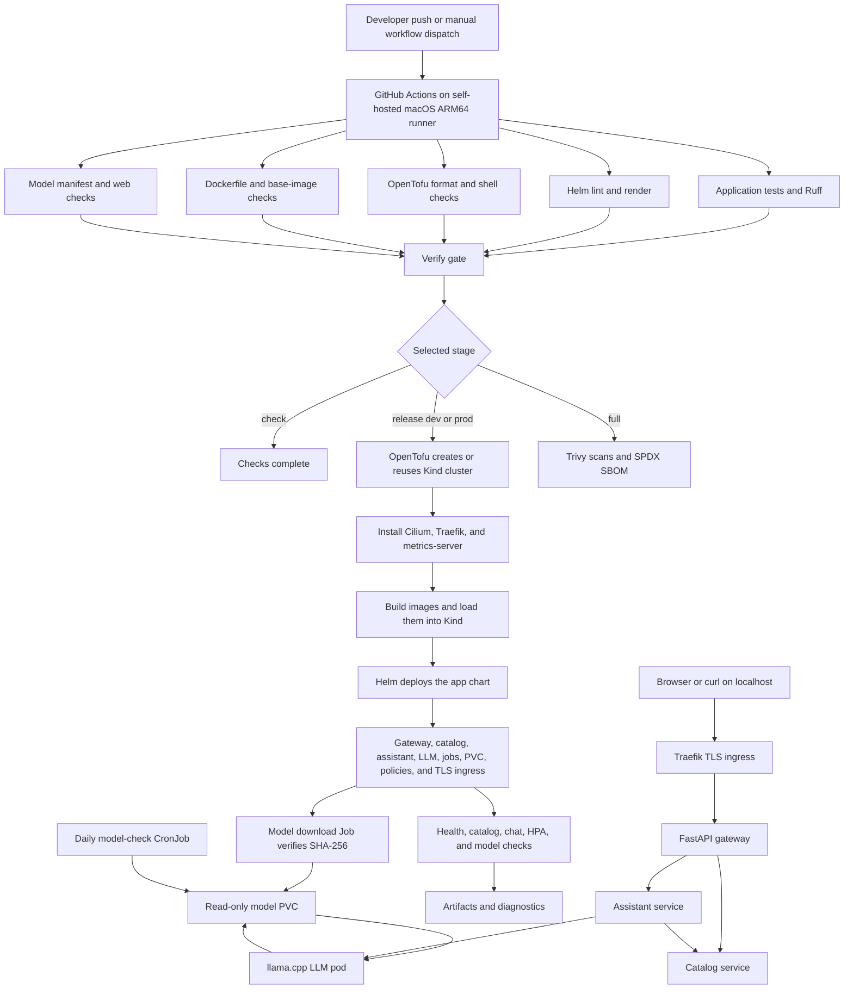

# End-to-End Workflow

This guide explains how a change moves from a Git commit to a working local LLM application on a Kind Kubernetes cluster.

## Workflow diagram



## What happens at each stage

1. **A change starts the pipeline.** A push to `main`, a pull request, or a manual Actions run starts the workflow. Release and full-scan stages are selected manually because they use the local Kind cluster and self-hosted Mac runner.

2. **Five checks run independently.** The pipeline checks application code, Helm templates, OpenTofu and shell syntax, container base-image pinning, and model/web contracts. Running them in parallel shortens feedback time and keeps each check focused.

3. **The verify gate controls deployment.** The release stage runs only after all required checks pass. A `release-only` run is available when checks already passed and only the local deployment needs to be retried.

4. **OpenTofu creates or reuses the local cluster.** The `dev` environment creates the `llm-dev` Kind cluster and uses namespace `app-dev`. The `prod` environment uses `llm-prod`, namespace `app-prod`, and a separate state directory. The kubeconfig is stored outside the repository.

5. **Cluster platform services are installed.** Cilium provides network policy enforcement, Traefik provides the localhost TLS ingress, and metrics-server supplies resource metrics for the gateway HPA.

6. **Images are built locally and loaded into Kind.** The application and `llama.cpp` images are built on the Mac. `kind load docker-image` puts them directly into the cluster, so a public container registry is not required.

7. **Helm deploys the application.** The chart creates the gateway, catalog, assistant, and LLM deployments; services; probes; resource limits; HPA/PDB; TLS ingress; network policies; the model download Job; and the model-check CronJob.

8. **The model is downloaded and verified.** The model Job downloads the pinned Qwen GGUF file once, checks its expected size and SHA-256, and stores it on a PVC. The LLM pod mounts that PVC read-only. The scheduled model-check CronJob repeats the integrity check.

9. **A user request follows the application path.** The browser reaches `https://llm.local:<port>/`, Traefik terminates TLS and routes to the gateway, and the gateway sends requests to the catalog or assistant. The assistant reads the selected catalog item and calls the local LLM. The response returns through the gateway to the browser.

10. **Security controls apply throughout runtime.** Application containers run as non-root with dropped capabilities, read-only root filesystems, seccomp, probes, and resource limits. Cilium starts with default-deny networking and allows only the required service-to-service flows. Only the local gateway route is exposed.

11. **Verification produces evidence.** The release smoke test checks the model Job, all deployments, health, catalog, browser page, chat response, and HPA. Failures collect pod state, events, policies, and service logs under `artifacts/` for diagnosis.

## Main commands by phase

```bash
# Fast checks without deploying
./scripts/pipeline.sh check

# Build and deploy the development environment
./scripts/pipeline.sh release dev

# Verify the deployed environment
./scripts/demo.sh dev

# Run the full test, scan, and SBOM stage
./scripts/pipeline.sh full
```

For the detailed Kind, pod-access, API, and final verification commands, see the [verification section in the main README](README.md#kind-pod-access-and-final-verification).

## Useful mental model

- **GitHub Actions** coordinates the work.
- **The self-hosted Mac** performs the build and deployment.
- **Kind** provides the local Kubernetes cluster.
- **Helm** describes the application resources.
- **Cilium and Traefik** enforce and expose the network path.
- **The model PVC** keeps the verified local model available to `llama.cpp`.
- **The gateway** is the only user-facing application entry point.
